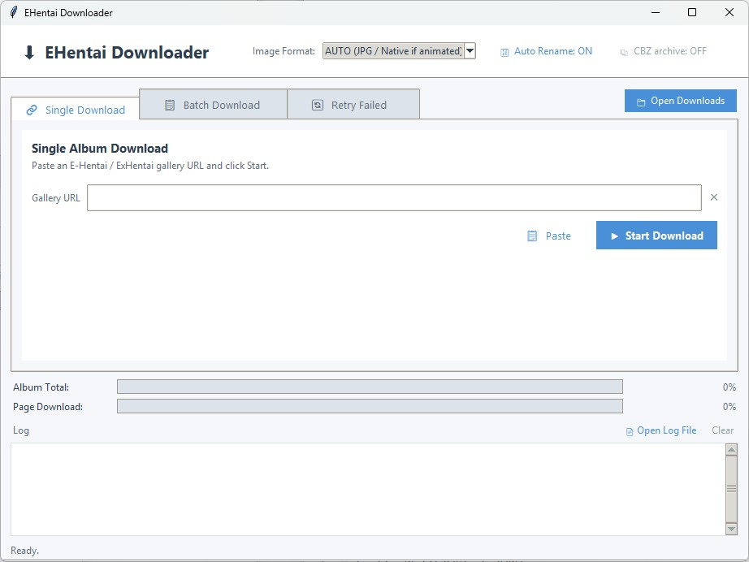

# E-Hentai Downloader

> A Python tool to download E-Hentai and ExHentai galleries, with a simple desktop GUI and a command-line interface.



> This project is a fork of [Lysagxra/EHentaiDownloader](https://github.com/Lysagxra/EHentaiDownloader), extended with a GUI, image format conversion, sequential renaming, smarter retries and more. It is distributed under the same license (GPL-3.0).

---

## Features

- 🖥️ **Desktop GUI** (Tkinter): single, batch and retry modes, live progress bars and a coloured log. Start it by double-clicking `EHentaiDownloader.pyw`.
- 🖼️ **Image format conversion**
  - **AUTO** (default): static images are converted to `.jpg`, animated images (animated GIF/WebP) keep their original format.
  - **Native**: save exactly what the server sends.
  - **JPG / PNG / WEBP**: force one format (animations are reduced to their first frame).
  - Uses **ImageMagick** when installed, otherwise **Pillow**.
- 🔢 **Sequential renaming**: when an album is fully downloaded, images are renamed `01…N`. The number of digits depends on the image count: up to 99 → 2 digits (`01`), up to 999 → 3 (`001`), up to 9999 → 4 (`0001`)… Toggle it with the **Auto Rename** button in the GUI header.
- 📚 **CBZ archives** (optional): each completed album is saved as a single `Downloads/<gallery title>.cbz` (no album folder), pages named `01…N` (zero-padded so every reader shows them in order) plus a `ComicInfo.xml`; the images and their temp folder are deleted only after the archive is verified (if it cannot be made, the album is saved as a normal folder). Toggle it with the **CBZ archive** button in the GUI header. Albums already archived are skipped on later runs.
- ✅ **Completeness check**: an album counts as complete only if every page is really on disk; otherwise it goes to the retry queue.
- 🛟 **Resilient downloads**
  - Network errors, timeouts and HTTP 429/5xx are retried with increasing waits.
  - If an image server is broken, another one is requested through the gallery's "reload" link.
  - The 509 "image quota exceeded" placeholder is detected: it is never saved as a page, and the album is queued for retry.
- ⚡ **Parallel downloads** with a thread pool and short courtesy pauses to avoid rate limits.
- ♻️ **Resume**: images already on disk (also from earlier runs or renamed files) are skipped. Every image is first written to a `.part` temp file and renamed only when complete, so an interrupted run can never leave a truncated image that looks finished (leftover `.part` files are deleted on the next run).
- 📋 **Batch mode** from `URLs.txt` and 🔄 **retry queue** in `failed_downloads.txt`.
- 🔍 **Link check before downloading**: malformed links (e.g. a token missing a character) are reported before starting; *Verify Links* also checks every gallery online and shows its title, size and the site it will be downloaded from (e-hentai.org or exhentai.org).
- 🧹 **Duplicate cleanup**: links pointing to the same gallery are detected (by gallery id, even with a different domain or a broken token) and removed after confirmation, keeping the valid link.
- 🏷️ **Clear lists**: after verification each line shows `GOOD/BAD | images | title | link`, and every error and failure summary names the gallery, not just its link.
- 🗂️ **Log rotation**: `session.log` rotates automatically (`session.log.1` … `session.log.3`).

---

## Requirements

- **Python 3.10+** (with Tkinter, included in the official Windows/macOS installers)
- Python packages: `beautifulsoup4`, `requests`, `rich`, `Pillow`
- *(Optional)* [ImageMagick](https://imagemagick.org/script/download.php) in the system `PATH` for faster conversions

---

## Installation

```bash
git clone https://github.com/LainX84/EHentaiDownloader.git
cd EHentaiDownloader
pip install -r requirements.txt
```

---

## ExHentai cookies (optional)

E-Hentai galleries work without logging in. ExHentai galleries and some restricted galleries need your account cookies.

1. Log in to e-hentai.org / exhentai.org in your browser.
2. Open the browser developer tools → *Storage* / *Application* → *Cookies*.
3. Copy `cookies.example.json` to `cookies.json` and fill in your values:

```json
{
  "ipb_member_id": "your_member_id",
  "ipb_pass_hash": "your_pass_hash",
  "igneous": "your_igneous_value"
}
```

A Netscape-format `cookies.txt` (exported by browser extensions) also works.

> ⚠️ **Never share or commit `cookies.json` / `cookies.txt`**: they give full access to your account. Both are already listed in `.gitignore`.

---

## Usage

### 1. GUI

Double-click **`EHentaiDownloader.pyw`** (Windows opens it without a console window), or run:

```bash
python EHentaiDownloader.pyw
```

| Area | What it does |
| :--- | :--- |
| **Image Format** | Output format for all downloads (see the table below). |
| **Auto Rename** | ON/OFF: rename images `01…N` when an album is complete. |
| **CBZ archive** | ON/OFF: save each completed album as `Downloads/<gallery title>.cbz` instead of a folder of images. |
| **Open Downloads** | Button on the right of the tab bar (always visible): opens the `Downloads` folder. |
| **Single Download** tab | Paste one gallery URL and press *Start Download*. |
| **Batch Download** tab | Editor for `URLs.txt`: one URL per line, lines starting with `#` are skipped. *Start Batch* first checks for duplicates and malformed links. The list is saved automatically every few seconds; while the batch runs you can keep adding links at the bottom and they are queued too. Links never verified are checked online in parallel with the download (unreadable ones are skipped and go to *Retry Failed*). Downloaded lines turn green and disappear after ~45 s; *Clear All* asks for confirmation. |
| **Duplicates** button | Finds links to the same gallery and, after confirmation, keeps one link per gallery. |
| **Verify Links** button | Checks every link online without downloading: title, number of images and source site (e-hentai.org / exhentai.org). Rewrites each line as `GOOD/BAD | images | title | link`, then offers to sort the list so galleries with fewer images are downloaded first (links with problems go to the bottom). |
| **Retry Failed** tab | Albums from `failed_downloads.txt`, in the same column format; press *Retry Failed* to try them again. |
| **Log** | Live events; *Open Log File* opens `session.log`. |

### 2. Command line

```bash
# Single gallery
python downloader.py https://e-hentai.org/g/3392858/1a77348e16/

# Every URL in URLs.txt (one per line), plus albums waiting in the retry queue
python main.py

# Retry only the albums in failed_downloads.txt
python retry.py
```

The CLI uses `DEFAULT_IMAGE_FORMAT`, `RENAME_SEQUENTIAL` and `CREATE_CBZ` from `src/config.py`.

### Link lists format

In the batch editor (and `URLs.txt`) just paste **one link per line**. After **Verify Links**, or once a gallery has been downloaded, each line is rewritten as columns:

```text
GOOD |   35 | [MeowWithMe] To Love Ru: Double Trouble | https://e-hentai.org/g/1908257/7261eadc3e/
BAD  |    - | (invalid link) | https://exhentai.org/g/4077626/00cb5bea6/
```

| Column | Meaning |
| :--- | :--- |
| `GOOD` / `BAD` | Whether the gallery page could be read with this link |
| `35` | Number of images in the gallery (`-` when unknown) |
| Title | Gallery title; for `BAD` lines, a short reason in brackets |
| Link | The gallery URL (always the last column) |

The same format is used in the *Retry Failed* list and in `failed_downloads.txt`. Lines starting with `#` are ignored; bare links and the older `URL  # title` form are still accepted.

A gallery link always ends with a **10-character token** (`/g/<number>/<token>/`). If a character is lost while copying, the site answers *"Key missing, or incorrect key provided"*: the program now detects this before downloading.

---

## Image formats

| Mode | Result |
| :--- | :--- |
| **AUTO** (default) | Static images → `.jpg`; animated GIF/WebP keep their format and animation. |
| **Native (Original)** | Whatever the server provides (`.webp`, `.jpg`, `.png`, `.gif`…), no conversion. |
| **JPG** | Everything converted to JPEG (animations keep only the first frame). |
| **PNG** | Everything converted to PNG (animations keep only the first frame). |
| **WEBP** | Everything converted to WebP. |

---

## Configuration

All settings are in [`src/config.py`](src/config.py):

| Setting | Default | Meaning |
| :--- | :--- | :--- |
| `DOWNLOAD_FOLDER` | `Downloads` | Where albums are saved (one sub-folder per album). |
| `TEMP_FOLDER` | `temp` | Albums are downloaded here and moved to `DOWNLOAD_FOLDER` only when complete (incomplete ones stay here and are resumed by *Retry Failed*). |
| `AUTOSAVE_INTERVAL` | `10` | Seconds between automatic saves of the batch list to `URLs.txt`. |
| `DONE_LINE_REMOVE_DELAY` | `45` | Seconds a downloaded (green) line stays in the batch list before being removed. |
| `MAX_WORKERS` | `5` | Images downloaded in parallel. |
| `DEFAULT_IMAGE_FORMAT` | `auto` | Format used by the command-line scripts. |
| `RENAME_SEQUENTIAL` | `True` | Rename images `01…N` when an album is complete (initial state of the GUI button). |
| `CREATE_CBZ` | `False` | Save each completed album as `Downloads/<gallery title>.cbz` instead of a folder (initial state of the GUI button; also used by the CLI). |
| `IMAGE_SERVER_RETRIES` | `3` | Different image servers tried per page. |
| `IMAGE_FETCH_RETRIES` | `3` | Attempts on the same image server before switching. |
| `PAGE_FETCH_RETRIES` | `3` | Attempts for HTML pages on temporary errors. |
| `ALBUM_PAGE_DELAY` | `(0.5, 1.5)` | Random pause (seconds) between gallery pages. |
| `CONNECTION_TIMEOUT` | `30` | Network timeout in seconds. |
| `RATE_LIMIT_SLEEPING_TIME` | `60` | Wait in seconds after a rate-limit response. |
| `SESSION_LOG_MAX_BYTES` / `SESSION_LOG_BACKUPS` | `5 MB` / `3` | Log rotation size and number of old logs kept. |
| `USER_AGENT` | Firefox | Browser identity sent with every request. |

---

## How downloading works

1. The link is checked (format), then the gallery page is read to get the title, the number of images and the list of gallery pages. If the requested site does not answer correctly, the other one (e-hentai.org ↔ exhentai.org) is tried; the log line `Source` says which one is used.
2. For every image page, the direct image link is taken from the image viewer page.
3. Images are downloaded in parallel into `temp/<album>/`, converted if needed, and saved as `NN_originalname.ext` while the album is in progress (each one through a `.part` temp file).
4. When nothing failed and every page is on disk, the images are renamed `01…N` (if enabled) and the album is moved to `Downloads/<clean gallery title>`. With **CBZ archive** ON, the images are instead packed straight from `temp/` into `Downloads/<clean gallery title>.cbz` and the temp folder is removed.
5. Albums with missing images stay in `temp/` and are written to `failed_downloads.txt` for a later retry; images already downloaded are not downloaded again.

---

## Troubleshooting

| Message in the log | Meaning / fix |
| :--- | :--- |
| `Image limit … 509` | Your E-Hentai image quota is exhausted. Wait (or reset it from your account), then use *Retry Failed*. |
| `cookies rejected … igneous=mystery` / `Sad Panda` | ExHentai cookies missing, expired or wrong: update `cookies.json`. |
| `IP restricted or temporarily banned` | Too many requests: wait before trying again, and consider lowering `MAX_WORKERS`. |
| `CBZ failed` / `CBZ skipped` | The archive could not be written or verified (or pages were duplicated): the album is saved as a normal folder instead, nothing is lost. |
| `Rename skipped` | Some pages were missing or duplicated on disk, so images were left with their download names. |
| `Invalid gallery URL … token` / `Key missing, or incorrect key provided` | The link is incomplete or mistyped: copy it again from the browser. |
| `exhentai.org did not answer correctly, using e-hentai.org` | ExHentai is down or your cookies are not valid: the gallery is downloaded from e-hentai.org instead (only works for galleries that exist there). |

---

## Project structure

```
EHentaiDownloader/
├── EHentaiDownloader.pyw    # GUI (double-click to start on Windows)
├── downloader.py            # CLI: single gallery
├── main.py                  # CLI: batch download from URLs.txt
├── retry.py                 # CLI: retry failed_downloads.txt
├── cookies.example.json     # Template for your ExHentai cookies
├── .pylintrc                # Pylint settings used by the GitHub Actions check
├── requirements.txt
├── assets/                  # README images
└── src/
    ├── config.py            # All settings
    ├── file_utils.py        # Files, folder names, session log + rotation
    ├── general_utils.py     # HTTP session, cookies, page fetching with retries & diagnostics
    ├── crawler/
    │   ├── crawler.py       # Gallery parsing: title, image count, page list
    │   └── crawler_utils.py # Link helpers ("reload" token, picture pages)
    ├── downloader/
    │   ├── album_downloader.py  # Download, conversion, completeness check, renaming
    │   └── download_utils.py    # Image requests with retries and backoff
    └── managers/            # Rich terminal display used by the CLI
```

Files created at runtime (and ignored by git): `Downloads/`, `temp/`, `URLs.txt`, `failed_downloads.txt`, `session.log*`, `cookies.json`.

---

## Disclaimer

This tool is for personal use. Respect the website's terms of service and do not overload its servers.

## License

Released under the [GNU General Public License v3.0](LICENSE), like the original project by [Lysagxra](https://github.com/Lysagxra/EHentaiDownloader).
