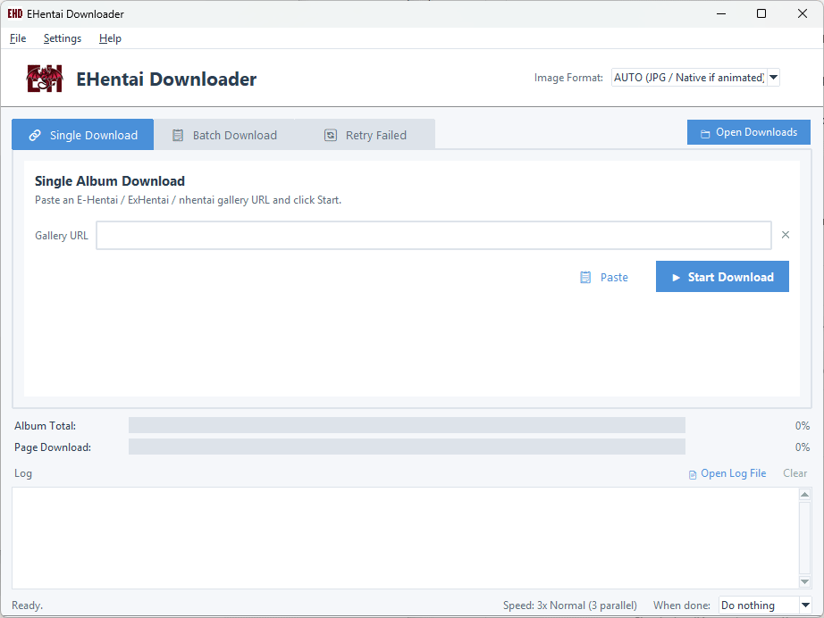

<p align="center"></p>

# E-Hentai Downloader

> A Python tool to download E-Hentai, ExHentai and nhentai galleries, with a simple desktop GUI and a command-line interface.



> This project is a fork of [Lysagxra/EHentaiDownloader](https://github.com/Lysagxra/EHentaiDownloader), extended with a GUI, image format conversion, sequential renaming, smarter retries and more. It is distributed under the same license (GPL-3.0).

---

## What's new in 2.0.1

- **One folder per site**: completed albums go to `Downloads/E-Hentai/` (e-hentai.org and exhentai.org) or `Downloads/nhentai/`.
- **Add many links at once**: paste any text (a web page, a chat message, a forum post) into the batch list, or drag links / `.txt` files onto the window: only the gallery links are kept, and galleries already in the list are skipped. Optional **clipboard watcher** (*Settings → Watch clipboard for links*).
- **Update check**: *Help → Check for updates now*, and a quiet check at start-up (at most once a day, can be turned off). The version is now shown next to the program name at the top of the window.
- **ComicInfo.xml is optional** (*Settings → ComicInfo.xml in CBZ*, OFF by default).
- **Batch list**: estimate of the images still to download; status bar counter of the images downloaded since the program was opened.
- **Safe file names on every system**: the same rules on Windows, macOS and Linux (no `? * : " < > |`, no Windows device names like `CON`), and long Chinese / Japanese titles are shortened to fit the 255-byte limit of Linux and macOS.
- Fixes for BAD lines of the link list and for the retry queue (text that is not a link is no longer kept).

All changes, also of earlier versions: [CHANGELOG.md](CHANGELOG.md).

---

## Features

- 🌐 **Three sites**: E-Hentai, ExHentai and **nhentai.net** (`https://nhentai.net/g/<number>/`). Paste the link as usual: the site is recognised automatically and the album is saved the same way (same formats, renaming, CBZ).
- 🎨 **Light, dark or automatic theme** (follows the Windows / macOS / Linux setting), from **Settings → Theme**.
- 🧭 **Menu bar**: *File* (folders, log, account cookies), *Settings* (Auto Rename, CBZ, Speed, When done, Theme), *Help* (GitHub, report a problem, disclaimer, license, about).
- 🖥️ **Desktop GUI** (Tkinter): single, batch and retry modes, live progress bars and a coloured log. Start it by double-clicking `EHentaiDownloader.pyw`.
- 📥 **Quick link input**: paste text with links (Ctrl+V in the batch list), drag links or text files onto the window, or let the clipboard watcher collect every gallery link you copy.
- 🗂️ **One folder per site**: `Downloads/E-Hentai/<title>` and `Downloads/nhentai/<title>` (or `.cbz`). Albums and archives made by older versions directly in `Downloads/` are still recognised.
- 🖼️ **Image format conversion**
  - **AUTO** (default): static images are converted to `.jpg`, animated images (animated GIF/WebP) keep their original format.
  - **Native**: save exactly what the server sends.
  - **JPG / PNG / WEBP**: force one format (animations are reduced to their first frame).
  - Uses **ImageMagick** when installed, otherwise **Pillow**.
- 🔢 **Sequential renaming**: when an album is fully downloaded, images are renamed `01…N`. The number of digits depends on the image count: up to 99 → 2 digits (`01`), up to 999 → 3 (`001`), up to 9999 → 4 (`0001`)… Toggle it in **Settings → Auto Rename**.
- 📚 **CBZ archives** (optional): each completed album is saved as a single `Downloads/<site>/<gallery title>.cbz` (no album folder), pages named `01…N` (zero-padded so every reader shows them in order) plus, if you want, a `ComicInfo.xml` (**Settings → ComicInfo.xml in CBZ**, OFF by default); the images and their temp folder are deleted only after the archive is verified (if it cannot be made, the album is saved as a normal folder). Toggle it in **Settings → CBZ archive**. Albums already archived are skipped on later runs.
- ✅ **Completeness check**: an album counts as complete only if every page is really on disk; otherwise it goes to the retry queue.
- 🛟 **Resilient downloads**
  - Network errors, timeouts and HTTP 429/5xx are retried with increasing waits.
  - If an image server is broken, another one is requested through the gallery's "reload" link.
  - The 509 "image quota exceeded" placeholder is detected: it is never saved as a page, and the album is queued for retry.
- ⚡ **Parallel downloads** with an adjustable **speed** (**Settings → Speed**, 1x Very slow … 5x Very fast): it sets the pause between page requests, shared by all threads, and how many images download at once. One page request per image (the "reload" link is used only when an image server fails).
- ⏸ **IP-ban pause**: when E-Hentai answers *"This IP address has been temporarily banned … The ban expires in X minutes and Y seconds"*, the ban time is read from the page and every download pauses for that long plus 30–45 s, then resumes the same album (it never skips to the next one). When nhentai answers *Too Many Requests* (HTTP 429) the same pause is used, for the time asked by the site plus a random 10–15 s. The status bar shows a warning with a countdown; after switching IP (e.g. with a VPN) press **Resume now**.
- ♻️ **Resume**: images already on disk (also from earlier runs or renamed files) are skipped. Every image is first written to a `.part` temp file and renamed only when complete, so an interrupted run can never leave a truncated image that looks finished (leftover `.part` files are deleted on the next run).
- 📋 **Batch mode** from `URLs.txt` and 🔄 **retry queue** in `failed_downloads.txt`.
- 🔍 **Link check before downloading**: malformed links (e.g. a token missing a character) are reported before starting; *Verify Links* also checks every gallery online and shows its title, size and the site it will be downloaded from (e-hentai.org, exhentai.org or nhentai.net).
- 🧹 **Duplicate cleanup**: links pointing to the same gallery are detected (by gallery id, even with a different domain or a broken token) and removed after confirmation, keeping the valid link.
- 🏷️ **Clear lists**: after verification each line shows `GOOD/BAD | images | title | link`, and every error and failure summary names the gallery, not just its link.
- 🗂️ **Log rotation**: `session.log` rotates automatically (`session.log.1` … `session.log.3`).

---

## Download (no Python needed)

Ready-to-use versions are attached to every [release](https://github.com/LainX84/EHentaiDownloader/releases/latest):

| System | File | How to start |
| :--- | :--- | :--- |
| **Windows** 10/11 (64-bit) | `EHentaiDownloader-<version>-windows-x64.zip` | Unzip anywhere and double-click `EHentaiDownloader.exe`. Windows SmartScreen may warn about an unknown publisher (the app is not signed): *More info → Run anyway*. |
| **macOS** Apple Silicon (M1…) | `EHentaiDownloader-<version>-macos-arm64.zip` | Unzip and move `EHentaiDownloader.app` to *Applications*. The app is not signed by Apple: the first time, right-click it → *Open* → *Open* (or *System Settings → Privacy & Security → Open Anyway*). |
| **macOS** Intel | `EHentaiDownloader-<version>-macos-x64.zip` | As above. |
| **Linux** x64 | `EHentaiDownloader-<version>-linux-x64.tar.gz` | `tar xzf EHentaiDownloader-*-linux-x64.tar.gz`, then run `EHentaiDownloader/EHentaiDownloader`. |

Where the app keeps its files (`Downloads/`, `temp/`, `URLs.txt`, `cookies.json`, `settings.json`, `session.log`):

- **Windows / Linux**: in the folder of the executable ("portable": move the folder and everything moves with it). If that folder can't be written (e.g. *Program Files*), `EHentaiDownloader` in your home folder is used.
- **macOS**: `~/EHentaiDownloader` (in your home folder).

*Help → About* shows the folder in use. ImageMagick is optional for the packaged app too (Pillow is included).

---

## Requirements (to run from the source code)

- **Python 3.10+** (with Tkinter, included in the official Windows/macOS installers; on Linux install it with the system package, e.g. `sudo apt install python3-tk` on Debian/Ubuntu, `sudo dnf install python3-tkinter` on Fedora)
- Python packages: `beautifulsoup4`, `requests`, `rich`, `Pillow`, and `tkinterdnd2` for drag and drop (optional: without it everything else works)
- *(Optional)* [ImageMagick](https://imagemagick.org/script/download.php) in the system `PATH` for faster conversions

---

## Installation (from the source code)

```bash
git clone https://github.com/LainX84/EHentaiDownloader.git
cd EHentaiDownloader
pip install -r requirements.txt
```

---

## ExHentai cookies (optional)

E-Hentai galleries work without logging in. ExHentai galleries and some restricted galleries need your account cookies.

**Easiest way, from the GUI: File → Account & cookies…**

1. Press the button of the site: the login page opens in your usual browser (any browser: Chrome, Chromium, Edge, Firefox, also Flatpak / Snap installs). Log in.
2. Open the developer tools (F12, or Cmd+Option+I on macOS) → *Application* / *Storage* → *Cookies* → the site, select the cookie rows and copy them (or export a `cookies.txt` with a browser extension).
3. Press **Paste** (or **Import cookies.txt…**): the program reads only `ipb_member_id`, `ipb_pass_hash` and `igneous`, ignores everything else, and **Save** writes `cookies.json` for you.

The same window has an optional field for an **nhentai API key** (not needed; with it the API limit goes from 20 to 45 requests per minute).

By hand: copy `cookies.example.json` to `cookies.json` and fill in your values:

```json
{
  "ipb_member_id": "your_member_id",
  "ipb_pass_hash": "your_pass_hash",
  "igneous": "your_igneous_value"
}
```

A Netscape-format `cookies.txt` (exported by browser extensions) also works.

## nhentai (nothing to set up)

nhentai galleries work without an account and without cookies. The program reads the whole gallery with **one request** to the site's public API v2 (`/api/v2/galleries/<id>`; the gallery page is used if the API does not answer), gets the list of image servers from `/api/v2/cdn` once per run, and then downloads the images, switching to another server if one does not answer.

The API allows **20 requests per minute per IP** without an account: API requests are spaced by at least 3.2 s (`NHENTAI_API_INTERVAL`), they follow the **Speed** and the **Pause** button, and HTTP 429 (*Too Many Requests*) pauses every download for the time asked plus 10–15 s, with a warning and a countdown. Downloading a gallery takes 1–2 API requests, so even *Verify Links* on long lists stays within the limit.

Only if nhentai ever showed the program a Cloudflare check (*"Just a moment…"*) the log would say so: in that case you can add your browser's `cf_clearance` cookie and User-Agent to an optional `"nhentai"` section of `cookies.json` (see `cookies.example.json`). The User-Agent must be the one of the browser the cookie comes from. nhentai cookies are only sent to nhentai.net, and E-Hentai cookies are never sent to nhentai.

> ⚠️ **Never share or commit `cookies.json` / `cookies.txt`**: they give full access to your account. Both are already listed in `.gitignore`.

---

## Usage

The program is meant to be used through the **GUI**: every feature is there (menus, account cookies, themes, pause, speed, progress). The command line is kept only as an optional, legacy mode for whoever prefers it.

### 1. GUI (recommended)

Double-click **`EHentaiDownloader.pyw`** (Windows opens it without a console window), or run:

```bash
python EHentaiDownloader.pyw
```

| Area | What it does |
| :--- | :--- |
| **Image Format** | Output format for all downloads (see the table below). |
| **File** menu | *Open Downloads folder*, *Open log file*, *Account & cookies…* (fills `cookies.json`, see above), *Exit*. |
| **Settings → Auto Rename** | ON/OFF: rename images `01…N` when an album is complete. |
| **Settings → CBZ archive** | ON/OFF: save each completed album as `Downloads/<site>/<gallery title>.cbz` instead of a folder of images. |
| **Settings → ComicInfo.xml in CBZ** | ON/OFF (default OFF): also put a `ComicInfo.xml` (title, page count, source link) inside each new CBZ, for readers that use it. |
| **Settings → Watch clipboard for links** | ON/OFF (default OFF): every gallery link you copy (also several at once, inside any text) is added to the batch list, skipping galleries already listed. Links copied before you turn it on are ignored. |
| **Settings → Speed** | 1x Very slow … 5x Very fast (default 3x Normal), also shown bottom right (click it to change). Lower it if you get temporary IP bans. The request pace changes at once, the number of parallel downloads from the next album. |
| **Settings → Theme** | *Automatic (system)*, *Light* or *Dark*; the window changes at once. *Automatic* follows the system setting (checked every minute). |
| **Help** menu | GitHub page, *Report a problem* (GitHub issues), *Check for updates now*, *Check for updates at start-up* (ON by default, at most once a day: one request to the GitHub API, nothing is downloaded or installed), *Disclaimer*, *License* (GPL-3.0 and third-party software), *About*. |
| *Start-up notice* | At start the program shows the disclaimer (no warranty, use at your own risk, may stop working, developed with the help of Claude AI). *Decline and exit* closes the program; *Don't show this again for 30 days* hides it for a month (`DISCLAIMER_SNOOZE_DAYS`). |
| **Pause / Resume** | Next to *Start Batch*, active while a download runs: no new request starts (images already being received finish), freeing the bandwidth. On pause `URLs.txt` is saved and the album in progress stays in `temp/`, so you can also close the program (no confirmation asked) or shut down the PC: the next *Start Batch* resumes from that album, skipping the pages already on disk. |
| **When done** | Bottom right, and in **Settings → When done**: *Do nothing*, *Close program* or *Shut down PC* when all downloads are finished (handy for a list left running overnight). A 60 s countdown lets you cancel; the list and settings are saved first. You can change it while a download runs. It always starts as *Do nothing* (never remembered, so the PC is not switched off by surprise next time). |
| **Resume now** | Appears in the status bar during a temporary IP ban: stop waiting after you changed IP (VPN). If the ban is still active the pause simply starts again. |
| *Remembered settings* | Image Format, Auto Rename, CBZ archive, ComicInfo.xml, clipboard watcher, update check, Speed, Theme and the start-up notice choice are saved in `settings.json` as soon as you change them and restored at the next start (delete the file to go back to the `src/config.py` defaults). |
| **Open Downloads** | Button on the right of the tab bar (always visible, also in *File*): opens the `Downloads` folder (with the `E-Hentai` and `nhentai` sub-folders). |
| **Single Download** tab | Paste one gallery URL and press *Start Download*. If *Paste* finds several links in the clipboard, it offers to add all of them to the batch list. |
| **Batch Download** tab | Editor for `URLs.txt`: one URL per line, lines starting with `#` are skipped. **Ctrl+V** keeps only the gallery links of the copied text (a whole web page or message is fine) and adds those not already listed; you can also **drag** links, text or `.txt` files onto the window. *Start Batch* first checks for duplicates and malformed links. The list is saved automatically every few seconds; while the batch runs you can keep adding links at the bottom and they are queued too. Links never verified are checked online in parallel with the download (unreadable ones are skipped and go to *Retry Failed*). Downloaded lines turn green and disappear after ~45 s; *Clear All* asks for confirmation. |
| **Duplicates** button | Finds links to the same gallery and, after confirmation, keeps one link per gallery. |
| **Verify Links** button | Checks every link online without downloading: title, number of images and source site (e-hentai.org / exhentai.org). Rewrites each line as `GOOD/BAD | images | title | link`, then offers to sort the list so galleries with fewer images are downloaded first (links with problems go to the bottom). |
| **Retry Failed** tab | Albums from `failed_downloads.txt`, in the same column format; press *Retry Failed* to try them again. |
| **Log** | Live events; *Open Log File* opens `session.log`. |

### 2. Command line (optional, legacy)

A minimal mode without a window, kept for whoever wants it (scripts, servers without a desktop). It downloads from **E-Hentai, ExHentai and nhentai** exactly like the GUI, with the same files and settings, but it has none of the GUI tools (menus, Account & cookies window, pause, live speed change): settings come from `src/config.py` and `cookies.json`, and the speed is `DEFAULT_SPEED`. New features are developed for the GUI first.

Run these from the project folder (the one with `EHentaiDownloader.pyw`):

```bash
# Single gallery
python -m src.cli.downloader https://e-hentai.org/g/3392858/1a77348e16/

# Every URL in URLs.txt (one per line), plus albums waiting in the retry queue
python -m src.cli.main

# Retry only the albums in failed_downloads.txt
python -m src.cli.retry
```

The GUI and the command line share the same `URLs.txt` and `failed_downloads.txt`.

The CLI uses `DEFAULT_IMAGE_FORMAT`, `RENAME_SEQUENTIAL`, `CREATE_CBZ`, `CBZ_COMIC_INFO` and `DEFAULT_SPEED` from `src/config.py` (not the GUI choices saved in `settings.json`).

### Link lists format

In the batch editor (and `URLs.txt`) just paste **one link per line**. After **Verify Links**, or once a gallery has been downloaded, each line is rewritten as columns:

```text
GOOD |   35 | [MeowWithMe] To Love Ru: Double Trouble | https://e-hentai.org/g/1908257/7261eadc3e/
BAD  |    - | (invalid link) | https://exhentai.org/g/4077626/00cb5bea6/
```

| Column | Meaning |
| :--- | :--- |
| `GOOD` / `BAD` | Whether the gallery page could be read with this link |
| `35` | Number of images in the gallery (`-` when unknown) |
| Title | Gallery title; for `BAD` lines, a short reason in brackets |
| Link | The gallery URL (always the last column) |

The same format is used in the *Retry Failed* list and in `failed_downloads.txt`. Lines starting with `#` are ignored; bare links and the older `URL  # title` form are still accepted.

A gallery link always ends with a **10-character token** (`/g/<number>/<token>/`). If a character is lost while copying, the site answers *"Key missing, or incorrect key provided"*: the program now detects this before downloading.

---

## Image formats

| Mode | Result |
| :--- | :--- |
| **AUTO** (default) | Static images → `.jpg`; animated GIF/WebP keep their format and animation. |
| **Native (Original)** | Whatever the server provides (`.webp`, `.jpg`, `.png`, `.gif`…), no conversion. |
| **JPG** | Everything converted to JPEG (animations keep only the first frame). |
| **PNG** | Everything converted to PNG (animations keep only the first frame). |
| **WEBP** | Everything converted to WebP. |

### Building the app yourself

```bash
pip install -r requirements.txt pyinstaller
python tools/build.py
```

The archive for your system is written to `release/` (PyInstaller can only build for the system it runs on).

**Publishing a release** (maintainers): set `APP_VERSION` in `src/config.py`, add a section to `CHANGELOG.md`, commit, then push a tag with the same version:

```bash
git tag v2.0.1
git push origin v2.0.1
```

The GitHub workflow `.github/workflows/release.yml` builds Windows, macOS (Apple Silicon and Intel) and Linux on GitHub's servers and attaches the four archives to a new release with generated notes. *Actions → Build release → Run workflow* makes a test build without publishing (the archives can be downloaded from the run page).

---

## Configuration

All settings are in [`src/config.py`](src/config.py):

| Setting | Default | Meaning |
| :--- | :--- | :--- |
| `DOWNLOAD_FOLDER` | `Downloads` | Where albums are saved (one sub-folder per album). |
| `TEMP_FOLDER` | `temp` | Albums are downloaded here and moved to `DOWNLOAD_FOLDER` only when complete (incomplete ones stay here and are resumed by *Retry Failed*). |
| `AUTOSAVE_INTERVAL` | `10` | Seconds between automatic saves of the batch list to `URLs.txt`. |
| `DONE_LINE_REMOVE_DELAY` | `45` | Seconds a downloaded (green) line stays in the batch list before being removed. |
| `MAX_WORKERS` | `5` | Upper limit of images downloaded in parallel (the speed level picks 1…5). |
| `DEFAULT_SPEED` | `3` | Speed level on first start and for the CLI: 1 Very slow (4 s between page requests, 1 download), 2 Slow (2.5 s, 2), 3 Normal (1.5 s, 3), 4 Fast (0.8 s, 4), 5 Very fast (0.3 s, 5). |
| `DEFAULT_IMAGE_FORMAT` | `auto` | Format used by the command-line scripts. |
| `RENAME_SEQUENTIAL` | `True` | Rename images `01…N` when an album is complete (initial state of the GUI button on first start). |
| `CREATE_CBZ` | `False` | Save each completed album as `Downloads/<site>/<gallery title>.cbz` instead of a folder (initial state of the GUI button on first start; also used by the CLI). |
| `CBZ_COMIC_INFO` | `False` | Put a `ComicInfo.xml` inside each CBZ (initial state of the GUI option on first start; also used by the CLI). |
| `IMAGE_SERVER_RETRIES` | `3` | Different image servers tried per page. |
| `IMAGE_FETCH_RETRIES` | `3` | Attempts on the same image server before switching. |
| `PAGE_FETCH_RETRIES` | `3` | Attempts for HTML pages on temporary errors. |
| `ALBUM_PAGE_DELAY` | `(0.5, 1.5)` | Random pause (seconds) between gallery pages. |
| `NHENTAI_IMAGE_MIRRORS` | `i1`…`i4.nhentai.net`, `i.nhentai.net` | nhentai image servers used when the site's list (`/api/v2/cdn`) can't be read (a server that fails is moved to the end). |
| `NHENTAI_API_INTERVAL` / `NHENTAI_API_INTERVAL_KEY` | `3.2` / `1.4` | Minimum seconds between nhentai API requests without / with an API key (site limit: 20 / 45 per minute per IP). |
| `NHENTAI_BLOCK_EXTRA_WAIT` | `(10, 15)` | Random extra seconds waited after the time asked by nhentai on HTTP 429. |
| `DISCLAIMER_SNOOZE_DAYS` | `30` | Days the start-up notice stays hidden after *Don't show this again*. |
| `NHENTAI_MAX_MIRRORS` | `4` | nhentai mirrors tried per image before it is marked as failed. |
| `NHENTAI_IMAGE_DELAY` | `(0.4, 1.2)` | Random pause (seconds) after each nhentai image, per download thread. |
| `CONNECTION_TIMEOUT` | `30` | Network timeout in seconds. |
| `RATE_LIMIT_SLEEPING_TIME` | `60` | Wait in seconds after a rate-limit response. |
| `BAN_EXTRA_WAIT` | `(30, 45)` | Extra random seconds waited after a temporary IP ban expires. |
| `BAN_DEFAULT_WAIT` | `300` | Wait used when the ban page does not say how long the ban lasts. |
| `MAX_BAN_WAITS` | `10` | Bans in a row on the same page before giving up on it. |
| `SESSION_LOG_MAX_BYTES` / `SESSION_LOG_BACKUPS` | `5 MB` / `3` | Log rotation size and number of old logs kept. |
| `USER_AGENT` | Firefox | Browser identity sent with every request. |

---

## How downloading works

1. The link is checked (format), then the gallery page is read to get the title, the number of images and the list of gallery pages. If the requested site does not answer correctly, the other one (e-hentai.org ↔ exhentai.org) is tried; the log line `Source` says which one is used.
2. For every image page, the direct image link is taken from the image viewer page.
3. Images are downloaded in parallel into `temp/<album>/`, converted if needed, and saved as `NN_originalname.ext` while the album is in progress (each one through a `.part` temp file).
4. When nothing failed and every page is on disk, the images are renamed `01…N` (if enabled) and the album is moved to `Downloads/E-Hentai/<clean gallery title>` (`Downloads/nhentai/…` for nhentai). With **CBZ archive** ON, the images are instead packed straight from `temp/` into `Downloads/<site>/<clean gallery title>.cbz` and the temp folder is removed. Names follow the same rules on every system (characters not allowed on Windows become `_`, at most 255 bytes), so the `Downloads` folder can be copied anywhere.

nhentai galleries work the same way, except steps 1–2: title, tags and the image path of every page come from a single request (API v2, or the gallery page as a fallback), so no per-image page is loaded; each image is taken directly from an image server (another mirror, or another file type if the site's one is wrong, is tried on failure).

5. Albums with missing images stay in `temp/` and are written to `failed_downloads.txt` for a later retry; images already downloaded are not downloaded again.

---

## Troubleshooting

| Message in the log | Meaning / fix |
| :--- | :--- |
| `Image limit … 509` | Your E-Hentai image quota is exhausted. Wait (or reset it from your account), then use *Retry Failed*. |
| `cookies rejected … igneous=mystery` / `Sad Panda` | ExHentai cookies missing, expired or wrong: update `cookies.json`. |
| `IP temporarily banned by E-Hentai … Downloads paused` | Too many requests. Nothing to do: downloads resume by themselves when the ban ends (+30–45 s). Lower the **Speed** to avoid it, or switch IP with a VPN and press **Resume now**. |
| `CBZ failed` / `CBZ skipped` | The archive could not be written or verified (or pages were duplicated): the album is saved as a normal folder instead, nothing is lost. |
| `Rename skipped` | Some pages were missing or duplicated on disk, so images were left with their download names. |
| `Invalid gallery URL … token` / `Key missing, or incorrect key provided` | The link is incomplete or mistyped: copy it again from the browser. |
| `Too many requests: blocked for a while by nhentai` | nhentai asked to slow down (HTTP 429): every download pauses for the time asked plus 10–15 s, with a countdown in the status bar, then continues by itself. Lower the **Speed**, or switch IP with a VPN and press **Resume now**. |
| `Cloudflare browser check` (nhentai) | nhentai asked for a browser check: add `cf_clearance` and `user_agent` to the `"nhentai"` section of `cookies.json` (see *nhentai* above). |
| `gallery … does not exist or was removed from nhentai` | Wrong gallery number, or the gallery was deleted. |
| `exhentai.org did not answer correctly, using e-hentai.org` | ExHentai is down or your cookies are not valid: the gallery is downloaded from e-hentai.org instead (only works for galleries that exist there). |

---

## Project structure

```
EHentaiDownloader/
├── EHentaiDownloader.pyw    # Starts the GUI (double-click on Windows)
├── cookies.example.json     # Template for your ExHentai (and optional nhentai) cookies
├── .pylintrc                # Pylint settings used by the GitHub Actions check
├── .github/workflows/       # pylint.yml (Pylint + tests), release.yml (builds the apps)
├── .github/dependabot.yml   # Weekly pull requests for dependency / security updates
├── tests/                   # pytest tests (run: python -m pytest)
├── tools/build.py           # Builds the ready-to-use app with PyInstaller
├── tools/make_icons.py      # Makes logo / icons (assets/) from assets/logo_source.jpg
├── requirements.txt
├── CHANGELOG.md             # What changed in every version
├── assets/                  # README images, logo and app icons ("EHD" letters at 16–32 px)
└── src/
    ├── cli/
    │   ├── downloader.py    # CLI: single gallery + download logic shared with the GUI
    │   ├── main.py          # CLI: batch download from URLs.txt
    │   └── retry.py         # CLI: retry failed_downloads.txt
    ├── config.py            # All settings
    ├── file_utils.py        # Files, folder names, session log + rotation
    ├── general_utils.py     # HTTP session, cookies, page fetching with retries & diagnostics
    ├── nhentai.py           # nhentai: link check, gallery data (API v2 / page), image servers
    ├── throttle.py          # Speed levels (request pacing) and temporary IP-ban / rate-limit pause
    ├── paths.py             # Data folder and bundled files (source code or packaged app)
    ├── ui_theme.py          # Light / dark / automatic theme, platform fonts
    ├── gui_dialogs.py       # Start-up notice, Account & cookies, License, About windows
    ├── update_check.py      # Asks GitHub for the latest release
    ├── gui/
    │   ├── app.py           # Main window (EHentaiGUI), assembled from the modules below
    │   ├── layout.py        # Styles, menu bar, theme, tabs, progress bars, log
    │   ├── url_list.py      # Batch list editor, retry list, duplicates, estimates
    │   ├── link_intake.py   # Paste many links, drag and drop, clipboard watcher
    │   ├── workers.py       # Background download / link-check threads
    │   ├── when_done.py     # End-of-download summary, close / shut down, exit
    │   ├── updates.py       # Update check (Help menu)
    │   ├── live_manager.py  # Progress / log messages from the threads to the window
    │   └── style.py         # Colours, fonts, small widget helpers
    ├── cookie_import.py     # Reads pasted cookies / cookies.txt, writes cookies.json
    ├── crawler/
    │   ├── crawler.py       # Gallery parsing: title, image count, page list
    │   └── crawler_utils.py # Link helpers ("reload" token, picture pages)
    ├── downloader/
    │   ├── album_downloader.py  # Download, conversion, completeness check, renaming
    │   ├── nhentai_downloader.py # Same, for nhentai galleries
    │   └── download_utils.py    # Image requests with retries and backoff
    └── managers/            # Rich terminal display used by the CLI
```

Files created at runtime (and ignored by git): `Downloads/`, `temp/`, `URLs.txt`, `failed_downloads.txt`, `session.log*`, `cookies.json`.

---

## Disclaimer

This tool is for personal use. Respect the website's terms of service and do not overload its servers.

- The developer takes no responsibility for bans, blocks, account restrictions, copyright issues or any other problem coming from the use of this program.
- The program is free and provided **as is**, without any warranty: you use it at your own risk.
- The websites can change at any time, so the program may stop working, completely or in part. Bugs can be reported in the [issues](https://github.com/LainX84/EHentaiDownloader/issues), but a quick answer is not guaranteed; you are free to fork it and fix problems yourself, keeping the credits to the [original project](https://github.com/Lysagxra/EHentaiDownloader) and to this version.
- This version has been developed and modified with the help of **Claude AI** (Anthropic).

The same notice is shown when the program starts (*Help → Disclaimer* shows it again).

## License

Released under the [GNU General Public License v3.0](LICENSE), like the original project by [Lysagxra](https://github.com/Lysagxra/EHentaiDownloader).
