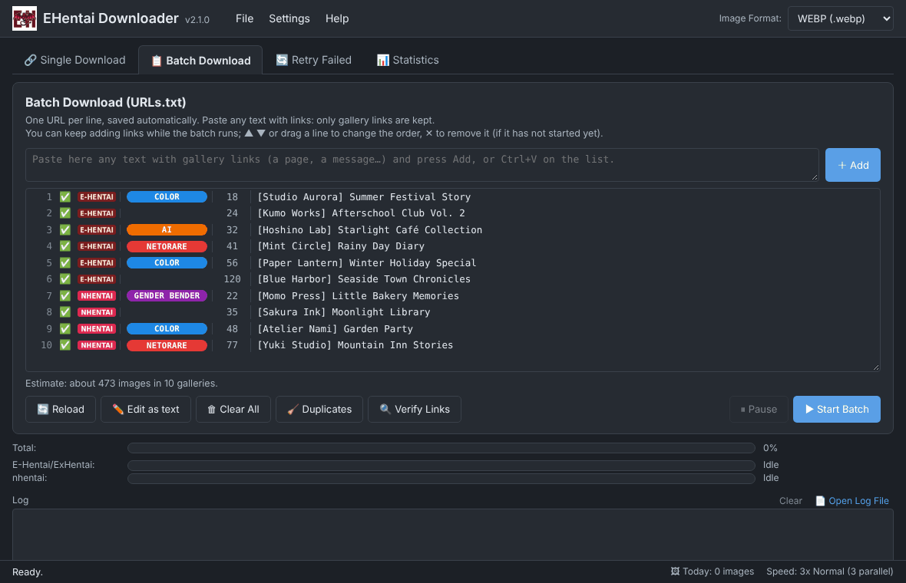

<p align="center"></p>

# EHentai Downloader – Docker (web interface)



Downloads **E-Hentai, ExHentai, nhentai and hitomi** galleries from a web page, for a home server
(NAS, mini PC, Raspberry Pi). It is the web version of the
[EHentai Downloader desktop program](https://github.com/LainX84/EHentaiDownloader): same
downloads, same files, same settings.

- **Images:** [Docker Hub `lainx84/ehentaidownloader`](https://hub.docker.com/r/lainx84/ehentaidownloader)
  and [GitHub Packages `ghcr.io/lainx84/ehentaidownloader`](https://github.com/LainX84/EHentaiDownloader/pkgs/container/ehentaidownloader)
  (same image on both)
- **Architectures:** `linux/amd64` and `linux/arm64`
- **Tags:** `latest` and the version (e.g. `2.2.0`); the image version is the same as the desktop program

> ⚠️ **No login.** The page is meant for the **home network only**: publish the port on the
> LAN address of the server, never on the internet (no port forwarding, no public reverse proxy).

---

## Quick start

`compose.yml`:

```yaml
services:
  ehentaidownloader:
    image: lainx84/ehentaidownloader:latest   # or ghcr.io/lainx84/ehentaidownloader:latest
    container_name: ehentaidownloader
    restart: unless-stopped
    user: "1000:1000"                         # owner of the files written in /data and /config
    environment:
      TZ: Europe/Rome                         # time zone of the log and of the daily counter
    ports:
      - "192.168.1.10:8099:8000"              # LAN address of the server : port of the page
    volumes:
      - /path/to/downloads/EHentaiDownloader:/data
      - ./config:/config
```

```bash
docker compose up -d
```

Then open `http://192.168.1.10:8099` (your server's address) and accept the notice shown at
the first visit.

With `docker run`:

```bash
docker run -d --name ehentaidownloader --restart unless-stopped --user 1000:1000 \
  -e TZ=Europe/Rome -p 192.168.1.10:8099:8000 \
  -v /path/to/downloads/EHentaiDownloader:/data -v "$PWD/config":/config \
  lainx84/ehentaidownloader:latest
```

The folders given to `/data` and `/config` must be writable by the user of `user:` / `--user`.

---

## Folders

| In the container | What is inside |
|---|---|
| `/data` | `E-Hentai/`, `nhentai/` and `hitomi/` (completed albums, folders or `.cbz`; with *folders by favorite tag* also `E-Hentai/<tag>/…`), `temp/` (albums still downloading), `cookies.json` |
| `/config` | `settings.json`, `URLs.txt` (batch list), `failed_downloads.txt` (retry queue), `stats.json` (statistics), `tags.json` (tags met in the galleries), `session.log` (+ rotated copies), optional `logos/` (your own site logos: `ehentai.png`, `exhentai.png`, `nhentai.png`, `hitomi.png`) |

Albums are downloaded into `temp/` and moved to `E-Hentai/`, `nhentai/` or `hitomi/` only when complete,
so the site folders never hold half albums. A stopped download is resumed from where it was,
skipping the pages already on disk.

## Environment variables

| Variable | Default | Meaning |
|---|---|---|
| `TZ` | UTC | Time zone (log times, daily image counter) |
| `EHD_DATA_DIR` | `/data` | Albums, `temp/`, `cookies.json` |
| `EHD_CONFIG_DIR` | `/config` | Lists, settings, log |
| `EHD_PORT` | `8000` | Port of the web page inside the container |

---

## The web page

Everything of the desktop window, from any browser of the house:

- **Single Download**, **Batch Download** (`URLs.txt`), **Retry Failed** (`failed_downloads.txt`) and **Statistics** tabs.
- **Clear lists, in columns**: `✅ | [site logo] | [ NETORARE ] | 123 | Gallery title` (favorite tag in
  its own colour, number of pages); the link is hidden but kept.
  Lines not started yet can be moved with ▲ ▼ or by dragging them, and removed with ✕, also
  while the batch runs: each site downloads in the order of the list.
- **Statistics**: galleries, images, size, time and speed (average, peak, now) since the first
  start and for this session, per site (E-Hentai, ExHentai, nhentai, hitomi), and the most downloaded tags.
- **Add links**: paste any text (a web page, a chat message…) in the box, press Ctrl+V on the
  list or **drag links, selected text or `.txt` files anywhere onto the page**: only gallery
  links are kept, galleries already listed are skipped. Links can be added while the batch runs.
- **E-Hentai / ExHentai, nhentai and hitomi download side by side**, one gallery per site at a time,
  each with its own progress bar, pace and ban pause.
- **Verify Links** (title, images, source site), then the list is sorted by site and size (also at
  Start Batch: E-Hentai / ExHentai first, then nhentai, then hitomi, fewer images first in each group),
  **Duplicates**, **Pause / Resume**, **Stop** (the galleries in progress finish, the rest stays
  in the list), **Cancel** (after a confirmation: everything stops now, `temp/`, the batch list
  and Retry Failed are emptied), **Resume now** after an IP ban.
- **Settings**: image format (Native / WEBP – default – / JPEG / JPEG XL / PNG / AVIF, all open and royalty-free), Auto Rename `01…N`, CBZ archive,
  ComicInfo.xml, **favorite tags** (tick them in the list of the tags met in your galleries, each with its
  own label, colour and priority; shown in the lists) and **folders by favorite tag**
  (`E-Hentai/<tag>/…`, `nhentai/<tag>/…`, `hitomi/<tag>/…`), speed (1x–5x), light / dark / automatic theme.
- **Status bar**: images downloaded **today** (the counter starts again every day at 06:00 and
  survives restarts), current speed, ban countdown.
- **Log** with colours; *File → Open log file* shows `session.log`.
- **Help**: update check, disclaimer, license, about.

The downloads run **inside the container**: they go on with the browser closed, and every open
page shows the same lists and progress.

Not in the web version (desktop only): the clipboard watcher (paste or drag the links onto the
page instead), *When done* (close / shut down: the server keeps running) and the
download folder setting (the albums go to the folder mounted on `/data`).

## Account cookies (ExHentai)

*File → Account & cookies…*:

1. **Read cookies from the browser**: log in to e-hentai.org (and exhentai.org) in your
   browser, open the developer tools (F12) → *Application / Storage → Cookies*, copy the cookie
   rows and paste them. Only `ipb_member_id`, `ipb_pass_hash` and `igneous` are kept; a
   `cookies.txt` export or a `Cookie:` header work too. The program writes `/data/cookies.json`
   by itself.
2. **Edit `cookies.json` directly**: once the file exists, the same window shows its content
   and you can change and save it (it must stay valid JSON). The optional nhentai section
   (`"nhentai": {"api_key": "…"}`) goes here too.

New values are used from the next gallery: no restart needed.

---

## Update

```bash
docker compose pull && docker compose up -d
```

Lists, settings, cookies and albums are in the two volumes, so nothing is lost. *Help → Check
for updates now* (or the daily check at start-up) tells when a new version is out.

## Build it yourself

From the project folder:

```bash
docker build -f docker/Dockerfile -t ehentaidownloader .
# or: docker compose -f docker/compose.yml up -d --build
```

Without Docker: `pip install -r docker/requirements-web.txt`, then `python -m src.web`
(folders from the variables above; default `./data`).

---

## Disclaimer and license

The developer takes no responsibility for bans, account restrictions, copyright issues or any
other problem coming from the use of this program: respect the terms of service of the sites
and the copyright of the works you download. Provided free of charge and **as is**, without
warranty. Developed and modified with the help of Claude AI (Anthropic).

Fork of [Lysagxra/EHentaiDownloader](https://github.com/Lysagxra/EHentaiDownloader), free
software under the [GPL-3.0 license](https://github.com/LainX84/EHentaiDownloader/blob/main/LICENSE).
Problems and ideas: [GitHub issues](https://github.com/LainX84/EHentaiDownloader/issues).
